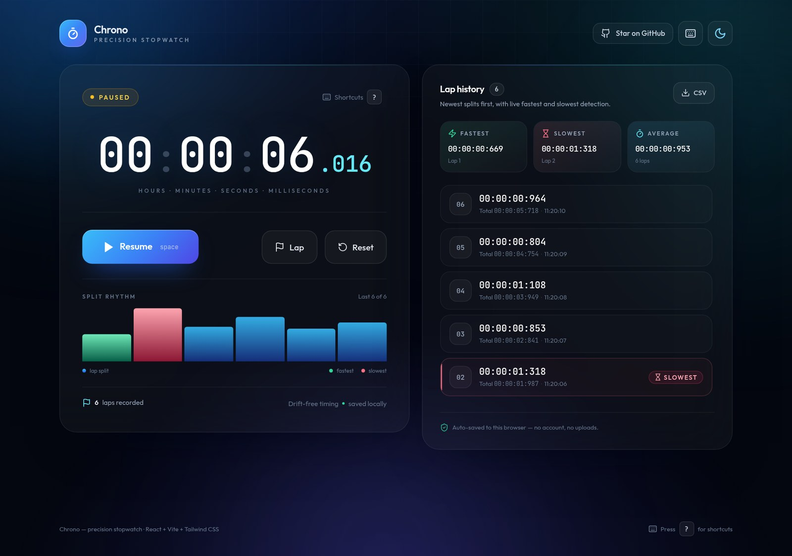
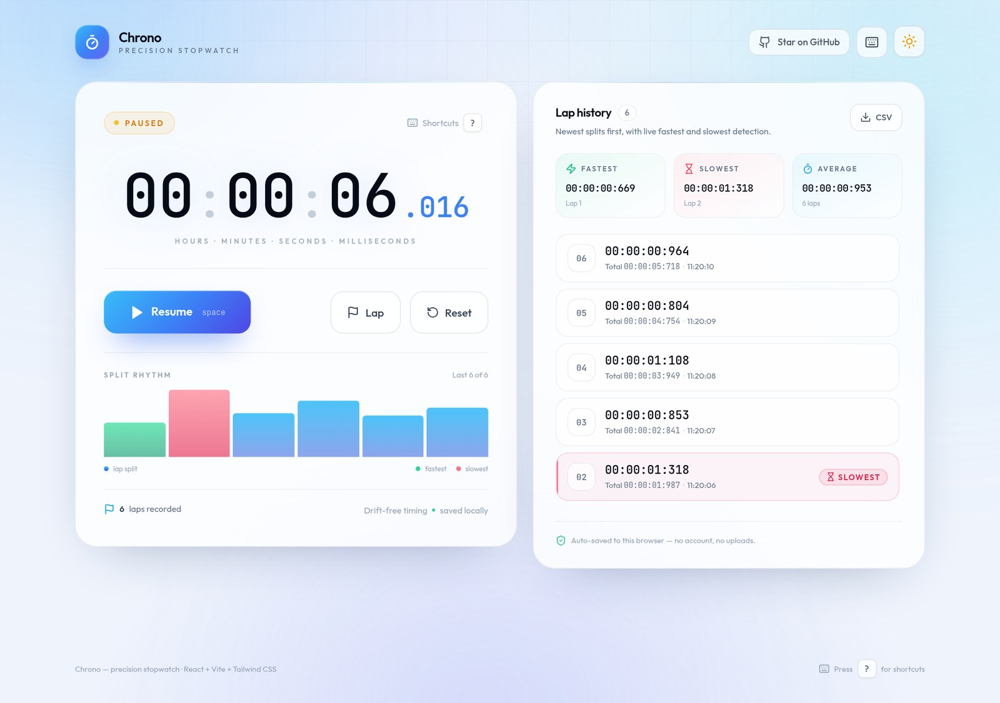
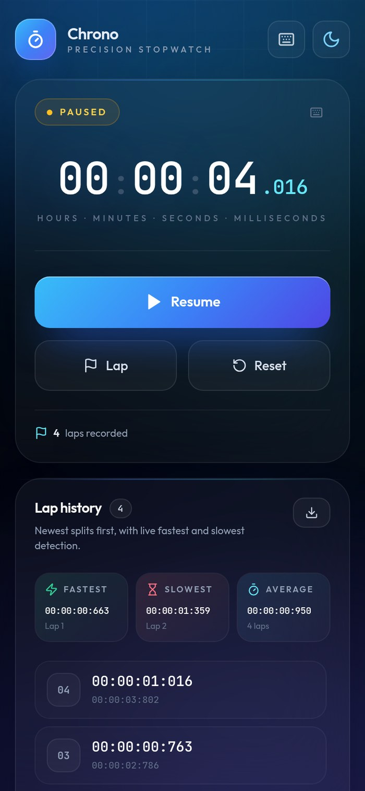

<div align="center">

# ⏱ Chrono

**A premium stopwatch for people who care about the last millisecond.**

Lap analytics · split chart · keyboard-first · dark & light · local-first · CSV export

[**Live Demo**](https://trymuseai.im/apps/48a022cdbd1ef08d/) · [Features](#features) · [Shortcuts](#keyboard-shortcuts) · [Run locally](#getting-started)

[](https://react.dev)
[](https://vite.dev)
[](https://tailwindcss.com)
[](https://lucide.dev)
[](LICENSE)



</div>

---

Most online stopwatches are a number and two buttons. Chrono is the one you keep open while
you practise, race, cook, or time a build: it records laps, shows you the fastest and slowest
split at a glance, survives a refresh, and hands you a clean CSV when you're done.

No sign-up. No server. Everything runs in your browser.

## Features

- **Drift-free timing** — the clock is derived from `performance.now()` timestamps, not from
  accumulated `setInterval` ticks, so slow frames and background tabs can't make it lose time.
- **Start · Pause · Resume · Reset** — one primary action that always tells you what it will do.
- **Laps with history** — newest first, with split and cumulative time for every lap.
- **Fastest & slowest detection** — live badges on the lap rows plus a stats row with the
  fastest, slowest and average split.
- **Split rhythm chart** — a tiny bar chart that makes pacing visible: green is your fastest
  lap, red is your slowest.
- **Dark & light mode** — premium navy-blue dark theme, clean daylight theme, remembered
  across visits.
- **Keyboard shortcuts** — run the whole app without touching the mouse (`Space`, `L`, `R`,
  `T`, `E`, `?`).
- **LocalStorage persistence** — the timer, laps and theme are restored after a refresh or a
  closed tab. Nothing is uploaded anywhere.
- **CSV export** — one click gives you `Lap, Lap Time, Lap Time (ms), Total Time,
  Total Time (ms), Recorded At` for spreadsheets.
- **Responsive & accessible** — a two-column dashboard on desktop, a thumb-friendly stack on
  mobile, real buttons, labels, focus rings, dialogs and `prefers-reduced-motion` support.
- **No runtime dependencies beyond React + Lucide** — icons are tree-shaken, the build is a
  static bundle you can host anywhere.

## Screenshots

| Light mode | Mobile |
| --- | --- |
|  |  |

## Keyboard shortcuts

| Key | Action |
| --- | --- |
| <kbd>Space</kbd> | Start, pause or resume |
| <kbd>L</kbd> | Record a lap |
| <kbd>R</kbd> | Reset the timer (confirmation first) |
| <kbd>T</kbd> | Toggle dark / light mode |
| <kbd>E</kbd> | Export laps as CSV |
| <kbd>?</kbd> | Open the shortcuts panel |
| <kbd>Esc</kbd> | Close the open dialog |

Shortcuts are ignored while you're typing and while a dialog is open, so you can't reset a run
by accident.

## Getting started

```bash
# clone
git clone https://github.com/Zabeeh-Ullah-Dev/Chrono-Stopwatch.git
cd Chrono-Stopwatch

# install
npm install

# develop
npm run dev

# production build
npm run build && npm run preview
```

Requires Node 18+ (built and tested on Node 20).

## How it works

**Timing.** The engine keeps two refs: the elapsed value at the last start and the
`performance.now()` timestamp of that start. Every animation frame it computes
`base + (now - startedAt)`, so the displayed value is always exact even if the tab was
throttled. React state is only used to paint, throttled to ~60fps.

**Laps.** A lap stores its split, cumulative total and wall-clock time. Stats are computed in a
single pass, so fastest/slowest stay correct as history grows.

**Persistence.** The session is checkpointed on every pause, lap and reset, once a second while
running, and on `pagehide`/`visibilitychange`. On load, the last snapshot is validated and
restored in a paused state.

**Export.** CSV is generated in the browser from the lap array, with a UTF-8 BOM so Excel opens
it cleanly, then downloaded through a Blob URL.

```
src/
├── components/     # TimerCard, TimeDisplay, LapPanel, LapRow, SplitChart, dialogs, toast
├── hooks/          # useStopwatch, useTheme, useKeyboardShortcuts
├── lib/            # time formatting, lap statistics, CSV generation
├── App.jsx         # wiring: persistence, shortcuts, export, dialogs
└── index.css       # design tokens, glass cards, motion
```

## Quality checks

The build was verified in a real Chromium browser with 30 automated checks covering start/pause
accuracy, frozen pause, lap recording, fastest/slowest badges, reload persistence, CSV contents
and ordering, theme switching and persistence, every keyboard shortcut, the reset confirmation,
mobile overflow, and console errors.

## Ideas welcome

If you'd like to take it further: session history (multiple runs), sound/haptic cues at each
lap, a countdown mode, or URL-shareable results. PRs and issues are open.

## License

[MIT](LICENSE) © [Zabeeh Ullah](https://github.com/Zabeeh-Ullah-Dev)

<div align="center">

If Chrono saved you a few seconds, a ⭐ helps other people find it.

</div>
